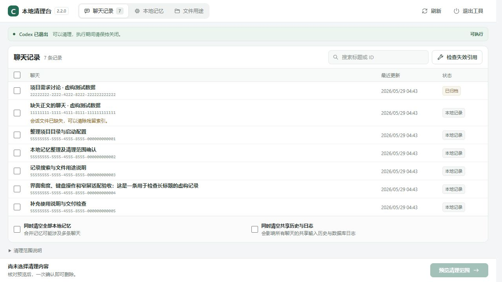

# CodexCleaner · Codex 本地清理台

Windows 桌面小工具：选择本机的 Codex 聊天与记忆，核对预览后确认清理。删除前保留可恢复备份，也可修复指向已删除聊天的失效引用。

**独立社区项目，与 OpenAI 无官方隶属关系。** 只支持已验证的本机存储结构；Codex 数据格式变化时会停止清理，等待工具适配。



## 使用

需要 64 位 Windows 10/11 和 [.NET 10 桌面运行时](https://dotnet.microsoft.com/download/dotnet/10.0)（Windows Desktop Runtime）。从 [Releases](https://github.com/XiaoBai620/CodexCleaner/releases/latest) 下载 `CodexCleaner.exe`（约 3 MB）双击运行。只需要这一个文件，SQLite 等依赖已打包在内，不需要附带 dll；放在任意目录都能运行，临时事务目录在 `%LOCALAPPDATA%\CodexCleaner`，与 exe 位置无关；没装运行时的话，Windows 会弹窗提示并给出下载地址。工具不占用端口。

启动后会在后台检查 GitHub 上的最新正式版本，有新版本时显示更新提示，也可点击“检查更新”。点击“前往更新”才会打开本项目的发布页，由你下载替换程序，不会自动下载安装。断网或检查失败不影响清理。

1. 按标题或 ID 搜索，也可按状态筛选。点选一行，在右侧查看完整标题、路径、消息数和处理原因；点击“查看对话”或双击行可只读查看对话。勾选框用于选择清理内容。“全选结果”选择当前筛选中的可清理聊天；底部统计包含筛选外已选记录。
2. Codex 开着也能清理：正在 Codex 中使用（已加载、或有子任务在跑）的聊天标为“使用中”，不能勾选；其他聊天可以直接预览并确认。运行期间不修改桌面界面状态（置顶、草稿等），退出 Codex 后点击“检查失效引用”清除残留。
3. “全部本地记忆”“共享输入历史与日志”默认不勾选，需要先完全退出 Codex 桌面应用和命令行才能选择。点击“预览清理范围”，逐项核对聊天、数据库、文件及保留的会话文件，再点击“确认清理”。
4. 清理时，状态栏显示当前阶段和累计执行秒数。成功清理后，备份仍保留；需要找回时先退出 Codex，点击“备份与恢复”，选择备份和聊天，预览后确认恢复。当前已有同 ID 的聊天会整条跳过，避免覆盖。全部记忆、共享历史与日志需要单独勾选，按整组恢复。
5. 运行中清理若只完成了一部分，先退出 Codex，再在“备份与恢复”中点击“处理未完成清理”。工具核对哪些数据仍处于本次操作的前后状态；有冲突时停止，保留故障材料。
6. 之前删除后在 Codex 里遇到项目或归档错误时，退出 Codex 后点击“检查失效引用”，核对后“确认修复”。

exe 没有代码签名，首次运行时 SmartScreen 可能提示“未知发布者”（点“更多信息”→“仍要运行”）。可以对照发布页的 `SHA256SUMS.txt` 核对文件：`certutil -hashfile CodexCleaner.exe SHA256`。

默认读取 `CODEX_HOME`，未设置时读取 `%USERPROFILE%\.codex`。聊天与记忆的读取、预览和清理都在本机完成。更新检查仅请求 GitHub 的公开版本信息，不上传聊天、记忆、文件路径、登录信息或本地文件。

更多说明见 [使用说明](docs/使用说明.md)，版本变化见 [更新记录](docs/CHANGELOG.md)。

显示“仅清理记录”的聊天仍可勾选。这表示会话路径为空、不受支持或位于当前数据目录外；清理会移除已验证的本地记录与关联数据，不会按该异常路径访问会话文件。预览会明确列出保留的文件；若与其他清理范围冲突，会停止并提示调整。原文件以后被再次导入时，聊天可能重新出现。

## 会删除什么

| 选项 | 处理内容 |
|---|---|
| 勾选聊天 | 已验证数据库中属于该聊天的记录、经过验证的原始会话文件（含分段文件和 `.jsonl.zst` 压缩副本）、会话索引、输入历史中带该会话 ID 的行、桌面状态中识别出的该聊天字段，以及该聊天直接提取的记忆。附着在它下面的子聊天会解除关联并保留。 |
| 仅清理记录 | 会话路径异常或未提供时，移除该聊天的本地记录与已识别关联；不按异常路径查找、读取或删除会话文件。 |
| 清空全部本地记忆 | 记忆提取结果、记忆整理任务，以及 `memories`、`memories_v2`、`memories_extensions` 里的文件。 |
| 清空共享输入历史与日志 | 桌面全局输入历史和 `logs_2.sqlite` 中的全部日志，会影响所有聊天。 |
| 检查失效引用 | 只清除指向已不存在聊天的本机引用，保留现存聊天、项目和远端主机记录。 |

项目、工作树、插件、技能、设置、登录信息和自动化定义都不在清理范围。被自动化任务引用的聊天不能删除，需要先在 Codex 里处理该任务；被其他分叉聊天当作历史来源的聊天需要和分叉聊天一起删除。删除是普通的本机删除，不是磁盘安全擦除；可从本工具删除前保留的备份中恢复受支持的内容。此前版本已删除且没有保留备份的数据无法由此找回，云端记录和外部备份不受影响。

## 备份与恢复

退出 Codex 后的清理、Codex 运行中的闲置聊天清理都会先保存并核对备份，再开始删除。默认位置为 `%LOCALAPPDATA%\CodexCleaner\Backups`；备份包含所选数据库行、原会话文件（含分段和 `.jsonl.zst`）及对应索引条目。备份只用于原数据目录；当前各数据库的存在状态、结构指纹和迁移记录必须与备份一致，发现未验证版本的数据库时拒绝恢复，不自动迁移旧备份。

普通聊天恢复包括数据库记录、原相对路径的会话文件、`session_index.jsonl` 和 `history.jsonl` 的对应条目。保留现有无关内容，不恢复置顶、草稿、窗口和标签状态。异常路径的“仅清理记录”只恢复记录与索引，不访问原异常路径；原先就缺失的文件不会凭空补齐。分叉聊天需要可用的父聊天历史；缺少父聊天、项目或分组等依赖时，先处理依赖再恢复。

“备份与恢复”显示每份备份的时间、会话数量和实际占用，可全选可恢复聊天，也可确认删除旧备份。清理前显示估计备份大小；实际占用可能因数据类型、页开销和原文件大小不同而增加。运行中清理还保存本次改写索引的完整前后内容作故障材料；离线清理及恢复会临时复制将修改的数据库，峰值空间高于持久备份大小。持久备份不会因恢复完成而自动删除，也没有自动过期策略；删除备份后，不能再从这份备份找回数据。

未完成的清理备份不能按普通备份恢复或删除，应使用“处理未完成清理”。修复只补回能核对为本次操作移除的内容；备份损坏、结构不兼容或当前内容无法判定时拒绝覆盖。运行中索引写入遇到可捕获异常时，会在同一文件锁内还原并校验；若中断后的索引不符合完整前后内容，也不只是追加了无关聊天的有效记录，则保留材料并拒绝自动恢复。多个数据库和文件不能跨文件原子提交，断电或回滚失败可能需要人工处理；请保留提示中的故障路径，不要自行删除故障材料。“检查失效引用”仍使用临时事务回滚，不生成可恢复的聊天备份。

## 兼容性与安全

- 支持的数据库结构来自 **2026-10-31** 的兼容性检查。工具会校验每个数据库的表和触发器定义指纹，任何一个不匹配都只允许浏览。
- 写入前检查 Codex 进程（包括商店版应用、命令行和数据目录内的 Codex 程序）。Codex 退出时按原有流程执行，并在过程中多次复查进程。
- Codex 运行时，按 Codex 自己的 `thread-writer-locks` 写入锁判断聊天是否在使用；执行时先占住所选聊天的写入锁和会话整理锁，再备份。每个数据库在写入事务内复查待删除行与备份一致后才删除；失败的库自动回滚，已完成部分由持久备份与故障处理入口保留恢复依据。
- 预览 15 分钟内有效。Codex 退出时绑定所有相关文件的数据指纹；运行时绑定所选聊天的更新时间和会话文件指纹。预览后有变化都会要求重新预览。
- 持久备份位于 `%LOCALAPPDATA%\CodexCleaner\Backups`，清理完成后保留。离线清理与恢复另将当前数据库和文件复制到 `Transactions` 用于失败回滚；只有临时事务副本在完成或回滚验证后移除。回滚本身失败时保留故障材料并锁定后续写入，界面会显示具体路径。
- 恢复要求 Codex 已退出，并占用会话整理锁和相关聊天写入锁。恢复前再次核对结构、依赖和冲突；恢复失败时还原操作前的数据，删除本次新建且内容未改变的文件，持久备份继续保留。
- 文件删除拒绝越界路径、符号链接、目录联接和硬链接。“仅清理记录”不放宽文件路径检查，也不能绕过数据库或自动化保护。

内部结构见 [架构与兼容性](docs/architecture.md)。

## 开发

需要 [.NET 10 SDK](https://dotnet.microsoft.com/)。

```text
dotnet test tests/CodexCleaner.Tests
dotnet publish src/CodexCleaner -c Release -o dist
```

测试在系统临时目录生成虚构数据，不读取也不修改真实的 `.codex`。性能和界面测量须先将 SQLite 用 backup API、其余普通文件直接复制到隔离临时目录，再将 `CODEX_HOME` 指向副本；不跟随链接、不把真实凭证或内容写入报告，测后清理副本。发布步骤见 [发布指南](docs/releasing.md)。

```text
src/CodexCleaner/        WinForms 桌面界面
src/CodexCleaner/Engine/ 清理引擎：结构校验、预览计划、事务执行与回滚、进程检测
tests/                   合成数据与回归测试
docs/                    使用说明、架构、发布、贡献与安全说明
```

欢迎提交修复和合成数据回归测试，请先读 [贡献指南](docs/CONTRIBUTING.md)；安全问题见 [安全说明](docs/SECURITY.md)。

## License

项目代码采用 [MIT](LICENSE)。第三方组件与兼容性数据来源见 [NOTICE](docs/NOTICE.md)。

## English

CodexCleaner is an independent native Windows utility for reviewing and deleting recognized local Codex chats and memories, with explicit previews and repair of stale local references. It ships as a single small exe that requires the .NET 10 Windows Desktop Runtime, refuses writes to unverified database schemas, deletes idle chats while Codex runs by holding Codex's own per-thread writer locks, and retains verified backups before deletion. Restore requires Codex to be closed and compatible database schemas, skips existing chats, and preserves unrelated data. Interrupted live cleanup has a separate recovery path; multi-file operations are not crash-atomic. It does not erase cloud records or perform forensic disk wiping.
